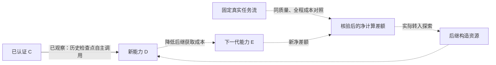

# 自主递归构造：组会进度与定位结果

- 日期：2026-11-03；本文件随当日上午真实运行更新。实验协议见[冻结协议](../research/evolution/recursive-construction-protocol-20261103.md)。
- 起点：main `2f29d34a` 已合并 PR #123。当前开发分支 `codex/recursive-construction-20261103`，新接口源码 `4af5c56f`；本轮已推送[草稿PR #124](https://github.com/jingyio/GeneLoop/pull/124)，尚未合并或部署；CI以该PR当前head为准。
- 研究问题：过去创造的抽象，是否能成为模型创造下一项能力的原语，并降低后继能力的获取成本？不能以工具数量、静态嵌套深度或宿主手写组合代替。

## 组会先说的结论

**已经首次观察到模型从初始能力池自主生成新比较逻辑、选择完整 C、构造并发布 D，在两个新论文项目的四项最终检查中全部通过，每项真实调用 C 两次。** 另有四对历史检查点的信息消融，显示续接协议能够显著改变复用行为与模型费用。自主递归构造已经有正面实证；完整的“净节余→再投资→D→E→新节余”反馈链尚未运行，当前也没有证明高层 C 的获取成本优于扁平方案。

## C 和 D 实际做什么

C 是已认证的论文引用一致性能力：从当前项目 ZIP 中跟踪可达 LaTeX 文件和活动书目，关联引用、条目、重复键、缺失与未使用条目，并保留文件/条目摘要。

D 增加跨版本关系：比较两个项目版本，定位文件与条目变化、受影响的正文文件，以及新出现或解决的一致性问题。它需要把 C 的两个结果用于新的差分和依赖传播判断；不是把两份报告拼起来。

## 一、为什么此前没有观察到自主 C→D

已证实的工程事实有三个：

1. **材料获取后缺少续接信息。** 历史 H0 第一次请求已经生成正确的3065字符比较器；认证入池后，旧构造上下文没有说明刚完成的获取、用途和新引用，模型随后转向重写整个程序。这个缺口不等于“既有完整组合计划被删”：原回答只表达了新程序，没有表达 C 的调用绑定。
2. **能力创造语言存在接口不对称。** 模型写完整程序时可直接进入原生认证并机械包装；写新关系逻辑并利用 C 时，必须先生成程序，再换一种 JSON 表达重新组织调用。普通 Python 不能直接使用已认证 C。
3. **当前任务可以被直接编码。** 历史 Direct 曾一次请求就得到合格完整程序，不能把它当成已经找到的预算能力边界。保留这个强基线，不能靠禁止重写或增加直接编码的协议调用制造优势。

现在已补材料续接记录，并增加“同一回答里的新程序＋显式组合意图”和受限 Python 调用语法。宿主固定模型选定的精确版本，仅在材料通过原生认证后解析新程序占位引用；不替模型选择 C、补算法或补绑定。静态调用语法编译成原有 IR，不执行生成的编排 Python，不绕过权限/版本/独立质量检查。完整程序的旧自动包装继续保留。

## 二、历史检查点的真实信息消融：已完成

### 条件与判据

- 输入状态：历史 H0 首个比较器真实认证完成的检查点。两组都有完全相同的 C、比较器、任务、能力池、模型、预算和验证标准；只开关 `material_continuation`。
- 四对八格，顺序请求前固定；每格完整获取回合研究预算 USD0.80。未首个成功即停，所有失败、修复与新材料费用均计入。
- main 不可变快照 `code-20`；DeepSeek Flash/off，`max_tokens=393216`。构造使用 ATC/LoRA 验证与后继输入；全部构造结束后统一执行 Mamba 两个版本对的回归。
- Mamba 已在此前查看，**这是定位/回归，不是新的盲测**；同一项目的两个版本对也不是两个独立项目。

### 完整结果

| 续接信息 | 已发布 D | 两对回归均合格 | 自主调用完整 C 的 D | 真实模型请求 | 全部模型估费 USD |
| --- | ---: | ---: | ---: | ---: | ---: |
| 有 | 4/4 | 4/4 | 2/4 | 10 | 0.005062164 |
| 无 | 3/4 | 2/4 | 0/4 | 12 | 0.068178516 |

| 回合 | 有续接：估费 / 结果 | 无续接：估费 / 结果 |
| --- | --- | --- |
| 0 | 0.001966884；完整 C；合格 | 0.009917220；完整重写；合格 |
| 1 | 0.000734904；完整 C；合格 | 0.015944436；未发布，质量未评审 |
| 2 | 0.000807804；展开底层材料；合格 | 0.010386420；完整重写；回归失败 |
| 3 | 0.001552572；展开底层材料；合格 | 0.031930440；完整重写；合格 |

两个使用完整 C 的模型候选都保留精确依赖；每次版本比较的原生回执均有 **2 次真实 C 调用**。宿主没有补 C 的调用或输出关系。有信息组另外两格自主展开使用底层材料，没有把它们算作完整 C→D。

另行核对原始 `assistant/message` 与候选草稿：on0最终请求3318、on1最终请求3325由模型自己写出三步 C(before)、C(after)、比较器，最终提案没有 `host_encoding`。on0先把ZIP路径直接给比较器、再误传 C.root，第三次传完整报告才修好；on1第二次修好。类型检查分别指出“应为对象、实际字符串”，没有宿主替模型补参数。

有信息四格最终都复用了原比较器，没有再生成算法；无信息四格均重写约10–16KB完整程序。无信息1的训练检查发现 `changed_files` 返回对象数组而契约要路径字符串数组，随后模型暂缓，最终质量未评审；无信息2按当前Tex文件目录解析 include，违背archive-root规则，漏掉嵌套文件及后续引用/传播/摘要。这是具体的重写风险，不是模型在预算内绝对做不到的证明。模型没有解释有信息2/3为何选择展开，不能替它编造选择动机。

有信息组的模型费用总计低 **92.575%**（差额 USD0.063116352），且四格均合格；这是相同已有材料池上的条件差异，**不是 C 对无 C 的因果收益，也不是全系统回本**。C 的历史获取估费 USD0.075317172、首比较器获取估费 USD0.002805468 单列，不能把它们算作免费。

逐请求原provider用量也支持“少重写算法”的解释：on累计输出1218 token，off为44710；on输入74471（缓存命中63744、未命中10727），off输入115783（命中68736、未命中47047）。这不只是费用表中的小数差异；四个on最终都沿已有材料组织短组合，四个off则重新输出完整算法。缓存/输入费用同样计入，不能只报输出token节省。

有信息组的组合执行约16–18秒/版本对，完整重写约3秒/版本对，存在原生进程/调用开销；因此模型费降低不等于总时延或机器经济成本降低。四对生成也不足以估计长期稳定成功率。

### 支持什么

- 支持：能力池中的抽象可以被模型自主用于新增能力；此前零 C 复用不能归因为 Runtime 无法递归。
- 支持：在这个真实检查点，保留材料用途与当前引用对模型的构造行为和费用产生了可观察的作用。
- 不支持：续接信息是唯一原因；完整 C 一定优于扁平 J；任意真实场景有效；完整效率反馈链已经闭合。

## 三、从初始池开始的新项目对照：已完成

研究 ID `generative-primitives-001`，源码 `4af5c56f`；Direct/L0、Flat/L0+J、WithC/L0+J+C 三组各两格，每格 USD2.00，普通 Python 与新增调用语法均可用，不强制 C。所有组共同增加“满足质量后降低完整能力获取成本”的目标，主输出与独立评价器保持。

新项目 DoRA、BitFit 的源码和受控版本在首请求前固定，按预定来源顺序及既有 C 输出契约选择，不按候选质量筛选；原文件不改。预定DPO源码下载成功，但旧受控版本生成器触发 `StopIteration`，保留准备失败后按顺序选择后两个；这也说明输入准备有适配范围，不能把筛选描述为只检查容量。四个最终转换属于两个项目。所有构造结束后再执行最终检查，最终反馈不进入本轮修复。该条件同时更新了接口与共同成本目标，不能把跨条件差异全部归因于单一补丁。

| 组 / 回合 | 全部模型估费 USD | 构造与最终结果 | 完整 C 调用 |
| --- | ---: | --- | --- |
| Direct 0 | 0.022659672 | 未发布；最终质量未评审 | 不适用 |
| Direct 1 | 0.005294580 | 已提交后继检查失败；最终质量未评审 | 不适用 |
| Flat 0 | 0.004704360 | 执行/发布失败；最终质量未评审 | 不适用 |
| Flat 1 | 0.011363040 | 完整重写；新项目4/4通过 | 0 |
| WithC 0 | 0.005216268 | 完整重写；新项目2/4通过 | 0 |
| WithC 1 | 0.017206164 | 自主新关系程序＋C组合；新项目4/4通过 | 每项2次，共8次 |

正式研究共 **16 次真实请求，估费 USD0.066444084，未知费用0**。所有六格已关闭并进入独立测量；无候选/后继失败的三格保持未评审，不能当作直接编码在预算内一定做不到的证据。

WithC 1 的成功原始回答包含模型新写的 **3273字符 JSON 比较程序**与三步组合：C(before)、C(after)、新程序。宿主在认证前固定模型的C版本与全部绑定，认证后只解析 `$program` 占位；最终提案由该固定意图编码，没有新增算法、依赖或参数。D版本为 `cap_c962563a382f4c1d2e1f598c`，在原ATC/LoRA独立检查与后继通过后，首次执行冻结DoRA/BitFit四项检查，全部通过。它和历史检查点的原比较器不是同一材料。

该真实成功使用JSON同答组合接口，**没有使用`composition_source`**；受限Python拼写前端目前只有确定性/原生诊断验证，不能写成模型已真实采用。

但是这一格用了 **5次模型请求**：两次新程序占位引用错误、两次把C原始报告误当作带`value`外壳的结果，最后修正。C的差分关系逻辑已能表达，构造成本仍被接口细节和类型适配抬高。作为同样4/4合格的对照，Flat 1完整重写费用0.011363040；该WithC格**反而多花 USD0.005843124，约51.4%**，尚未计C初始获取成本。因此本轮**完成自主递归事件的验收，没有证明高层抽象比扁平条件更省费**。也不能把只有描述/词汇差异造成的影响归因于真实C执行，描述信息对照仍待做。

若把两个重复的全部支出都计入，WithC为USD0.022422432，Flat为USD0.016067400，两组各只有一个最终四项全合格候选，WithC仍约贵39.6%；不是只拿成功回合比较后就忽略其余失败。

当前最有价值的下一处改进是减少由宿主决定的作者接口细节：新材料引用、语义结果与原生`value`包装的区别，不应继续靠模型反复猜。需保持所有组同样便利、保留完整代码基线，不通过强制C来制造成功。

### 失败已定位到具体层

- **WithC 0重写**：用set记录每个key的`(path,hash)`，丢掉完全相同的重复条目次数，所以两个项目的v0→v1都漏`changed_entry_keys`；v1→v2通过。已有C保留多重集语义，自主使用C的那格没有重写这段解析。
- **Flat 0组合**：把本来就是数组的`bib_files/entries`又套一层数组，J的真实输入出现`list[list[...]]`，worker失败。现有相关schema只有array而没有完整items结构，静态检查未挡住；发布层又把`cycle_execution_failed`作为不可修复错误而结束。这是类型信息与错误分类的具体缺口，不能算算法做不到。
- **Direct 1重写**：正则优先匹配`cite`且缺命令边界，把`citep`当成`cite`后跟`p`，漏掉LoRA后继的已解决缺引用。因此虽过前一验证，后继失败，未进入最终评审。
- **Direct 0重写**：include正则缺命令边界且接受裸参数，将可达文件13处`includegraphics`误当成`include`依赖，制造不存在的文件；独立验证只有`after_has_errors`错误，修复后仍选择同一错误程序而暂缓。
- **WithC 1构造**：两次占位引用写法不合协议，两次给C原始报告错误地加`value`字段路径。最后模型自己修正全部绑定，3273字符新关系程序与已认证C一起完成新任务。当前阻力集中在作者接口和参数类型，而不是递归执行器。

这组结果具体说明了“压缩低层不确定性，释放高层创造性”的动机：复用已验证的解析/一致性能力，可以把本轮新增逻辑集中到版本关系；重新生成完整算法会重新引入引用正则、重复条目和依赖路径等旧问题。但一次正例与这些反例还不能代替高层抽象创造价值的充分对照。

## 四、距离理论闭环还差什么

下一步要在同一预登记真实任务流与总预算里，扣除学习、检索、认证、失败与恢复后核验计算净差额，再让它实际支持 D/E 探索；固定预拨研究额度不是系统赚到的节余。旧视频收益与本次论文实验不是同一任务流，不能直接拼接为闭环。

后继对照应区分无 D、只有 D 描述、可执行 D，保留普通代码能力，不强制复用；只有观察到 D 降低 E 的获取成本，且后续任务再次产生可再投资的净差额，才将相应完整反馈标为已观察。最坏输出预留、已核验信用与真实支出也必须分开；信用不足时不能临时挪用预拨额度。

## 验证、费用与复现

- 最终源码本地全量：**1979 Python 通过/239跳过，1516 Node通过/20跳过**；服务器Linux原生与公共定向**129通过**，smoke及motif检查通过，均为无模型诊断。macOS 使用 `TMPDIR=/private/tmp` 规范化临时路径。原沙箱限制和临时路径别名造成的初次失败保留日志，没有删除有效守卫。
- 本次两阶段共**38次真实请求，估费USD0.139684764**（检查点22次/0.073240680，新项目16次/0.066444084）；此前夜间79次/USD0.340150572另外保留，两轮合计117次/USD0.479835336，没有把失败移出分母。全部为 provider 用量估费，供应商实付、Codex工程调试、人工及机器经济成本未知，不称总经济成本。
- 本次原始用量合计输入319773、输出85790、总计405563 token，输入缓存命中201344/未命中118429。38条都核对命中+未命中=输入、输入+输出=总量，原账本请求3316–3353全部结算且无未知；`research-usage-export.json`只导出用量和来源摘要，不含提示词或凭证。
- 本轮沿用原累计账本，未清零；无生产接管、外部应用写入、私人原件修改或投稿。
- 私有记录：`.local/recursive-construction-20261103/server-evidence/continuation-study-001/evaluation-001/summary.json`；服务器研究根使用同名私有目录。新项目原始源码、模型轨迹、配置与失败仅放私有目录，不入 Git。
- 最短复现入口：服务器加载私有 `.local/remote-env.sh`，在固定代码检出用 `node scripts/project.mjs python -m scenarios.paper_proofreading.frontier.run --request <已冻结request>`；新目录、新期限，不重发已封账回合。

## 一分钟口头汇报

我们研究的是过去学到的能力能否降低创造下一项能力的成本。昨晚系统能执行 C，却没有自主利用 C 构造 D。今天先用真实检查点的信息消融定位到：材料入池后丢失构造意图会让模型重写已有算法；保留续接信息后四次全合格，两次自主调用完整C，模型费局部低92.6%。随后补了能引用已认证能力的生成语言，从初始池重新运行，模型自主写了新的比较程序并调用C构造D，在两个新论文项目的四项检查中全部通过。这是新的自主递归证据。但这一格还为占位引用和结果包装修了几轮，成本比合格的完整重写对照更高，所以目前证明了自主递归构造，尚未证明抽象的创造效率优势。下一步先消除这些接口摩擦，再把同质量净计算节余、再投资与D→E接成同一条反馈链。
