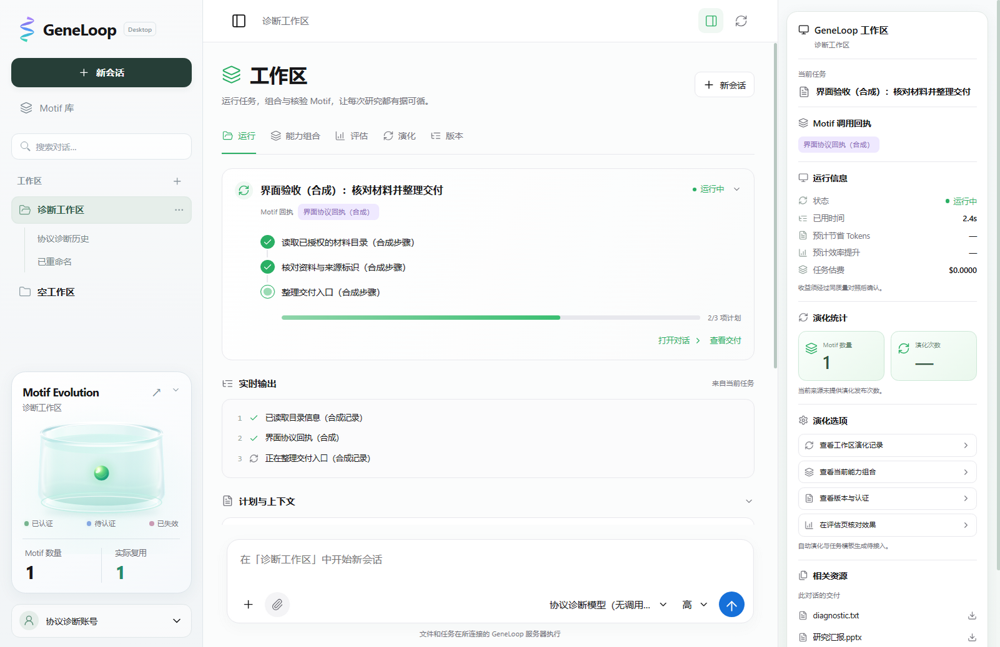
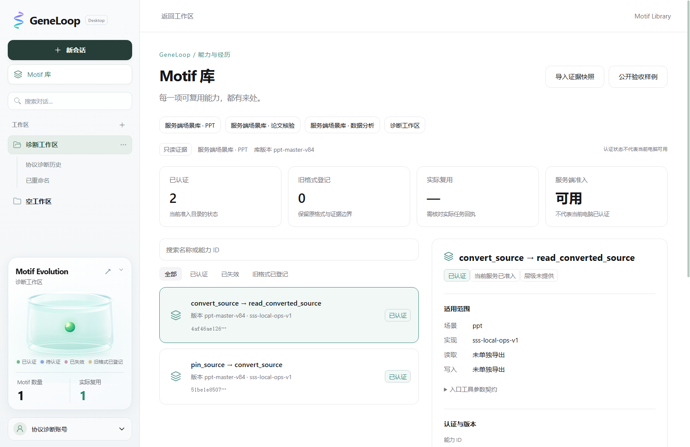

# 工作区中的 Motif 能力与演化

本模块在 `codex/motif-library-ui` 独立开发，不合入或覆盖 `codex/desktop-local-runtime` 的 Windows/Mac 工具迁移。从 main `d1863342` 开始，已整合 main `1d1e16f4`；保留现有桌面视觉、会话、草稿与工作区行为。

## 页面组织

- 工作区首页按用户定稿采用三栏：左侧导航，中央「运行、能力组合、评估、演化、版本」，最右侧独立工作区详情栏。运行页展示当前任务、公开计划、真实工具记录、计划与上下文、效果与用量；最近对话可展开。输入框继续沿用草稿流程。
- 最右侧详情栏包含当前任务、Motif调用回执、状态/耗时/估费、演化统计、已有页面入口及相关资源。详情栏独立滚动，可通过右上角按钮收起；窄于1180px时默认收起，手动打开为抽屉。左侧导航保持之前的搜索、层级、选中态、拖宽及菜单行为。
- 计划进度仅按任务公开todo的已完成项计算，不模拟阶段或估算整体完成度。缺少同质量对照时节省Tokens和效率提升显示破折号；没有演化发布记录时演化次数未知。演化区当前链接到已有只读页面，自动演化和模板生成明确标记待接入。
- 全局「Motif 库」按账号列出宿主已绑定的工作区，切换后浏览能力、认证状态、范围和证据。与工作区共用详情组件。
- 左下 Evolution 摘要随当前工作区变化，采用参考图的玻璃培养皿、立体球体和分栏统计。球体对应实际能力，最多绘制18个；数字仍为实际统计。颜色表示认证状态，不代表能力等级或收益。收起时保留两项数字；漂浮动画遵守系统减少动态效果设置。
- 展示端不授予执行权；快照中的「已认证」与当前电脑的可用性分开。当前可用性固定标记待核验，等待 Runtime 提供精确兼容检查。

Coding v1 提供环境、依赖锁、读写约束和 match/invoke/fallback。Runtime v2 另外直接读取主线原运行库的工具参数流、证书及学习报告兼容版本；没有 Motif 组合或学习/发布事件时，不生成父子层级或演化次数。

卡片视觉参考用户设想图，并调研了 [Magic UI](https://github.com/magicuidesign/magicui) 的粒子组件方向和 [GlassKit](https://github.com/JUNGHERZ/GlassKit) 的玻璃卡片方向。最终为本项目原生 SVG/CSS 绘制，没有复制其组件源码或新增 React、WebGL、动画库依赖。玻璃反光与水纹是光学装饰，不表示能力之间的结构关系。

## 后端接入

`scripts/harless_motif_view.ts` 通过现有账号网关提供 `GET /api/harless/motif-library`。已有登录 Cookie 决定账号；可用 `workspaceId` 参数缩小范围，不能指定文件路径。没有配置时返回空目录。正式服务仍需维护者按统一发布入口部署，本分支不改变运行服务。

宿主的私有网关配置（统一启动计划 `gateway_config` 指向的 JSON）可增加以下配置，路径指向原导出器生成的**脱敏展示快照**，不指向原始轨迹或凭证：

```json
{
  "motifEvidence": {
    "sources": [{
      "accountId": "example-account-id",
      "workspaceId": "example-workspace-id",
      "executionLocation": "cloud",
      "path": "/private/exports/coding-evidence.json"
    }]
  }
}
```

`accountId` 必须是账号稳定 ID。每账号、工作区一份当前快照；路径是宿主预先配置的物理绝对路径，拒绝链接、非普通文件、硬链接和超过4MiB的文件。客户端没有写入、注册或执行接口。配置中的执行位置只说明证据来源，不改变会话执行位置。

返回 `geneloop-motif-catalog-v1` 包装，含目录内容摘要 `revision`、工作区 ID、来源执行位置、读取状态、兼容性状态及原协议 `evidence`。不可读取的条目标记 `unavailable`，不泄露物理路径。此接口保留 Coding v1；Paper/PPT/Data 另通过原 Runtime 的 `GET /api/harless/motif-catalog` 自动读取，无需手工绑定 Coding 快照。

前端仅在已登录工作区可见时，每10秒读取一次；导出内容变化时更新页面，页面重新可见时立即读取。失败时保留旧证据并标示错误；退出或重新登录会清空内存与正在读取的请求。此版是快照自动更新，不声称逐事件流式推送。

任务详情另复用原 `GET /api/harless/tasks`，在可见工作区首页每4秒读取，不增加接口或执行器。列表再按本工作区可见会话过滤，绑定当前任务ID后读取原 `todos`、`trace`、`progress`、`duration_ms`、`stats`。已核验的 Motif 调用回执来自该任务的完成/优化记录，不将全库能力当作当前任务已使用的能力。工作区导出的匿名 `run_id/task_ref` 没有会话绑定时独立标注，不能强行关联到最近对话。

交付继续使用现有受保护的 comparisons/deliveries 路由；保留PPT实际图片预览、翻页与下载。只在精确任务绑定成立时标为任务交付，其余同会话原件标为「此对话的交付」。登出或授权失效时清理右栏和内存，异步回包检查原代次。页面组件在 `workspace-run.js`，没有新增依赖。

## 同伴协议与证据来源

协议、原消费逻辑和公开真实脱敏样例取自同伴在 Issue #150 的两条交付：

- [公开样例](https://github.com/jingyio/GeneLoop/issues/150#issuecomment-6674873020)
- [Schema 和 TypeScript 消费者](https://github.com/jingyio/GeneLoop/issues/150#issuecomment-6674898704)

`config/motif-evidence-v1.schema.json` 保留原 v1 协议；`src/adapters/motif_evidence_projection.ts` 复用消费逻辑，增加重复事件拒绝和统计投影。前后端共用投影；浏览器使用构建时生成的校验器，保持现有 CSP，不开启动态代码执行。

公开样例是历史宿主证据的展示联调，不是当前账号数据，也不是本轮新增真实任务。手动导入仅驻留内存，不会上传或绑定工作区。单项无法归因的费用和完整耗时保持「未知」；任务估费与单项费用分开，没有同质量配对基线时不计算节省。

## 本机开发

```powershell
npm ci
npm --prefix apps/desktop ci
npm --prefix apps/desktop run build
npm --prefix apps/desktop run check:motif
npm --prefix apps/desktop run check
npm --prefix apps/desktop run smoke:renderer
```

最后一项在回环协议服务中调用实际只读路由，验证工作区五视图、全局目录、样例标识以及浅深色页面。它不启动模型任务；原始回执和截图在 `apps/desktop/.local/validation/renderer-*`，不提交。完整回归状态见本模块交接。

## 当前界面

下图来自 Electron 回环界面的合成任务协议验收；任务、步骤和进度均已标明合成。能力目录使用 #150 的公开脱敏历史样例。它用于审阅布局，不是新的真实模型执行或收益对照。



## 前后端接线审计与修复（2026-11-08）

| 页面内容 | 真实来源 | 当前行为与边界 |
| --- | --- | --- |
| 注册场景库列表 | Runtime 当前 `scenes` 与原准入检查 | 自动读取 Paper/PPT/Data；当前原程序分别2/1/10项，后续随实际库变化，不硬编码数量 |
| 账号学习库 | 原 Paper/PPT learning resolver | 按原账号及 scope 解析，不另建存储；展示不触发学习或发布 |
| Coding 历史数据 | #150 / 原快照接口 | 保留明确绑定与公开样例；不把样例归入正式账号 |
| 详情、工具流、证书与来源 | 已加载库及绑定原件 | 只投影真实字段；不返回物理路径、源码或原始轨迹 |
| Data旧回执库 | 原 `data_receipts_v3` | 单独标为旧格式已登记，不冒充Paper/PPT同类认证 |
| 版本页 | 当前版本、原学习报告的兼容来源记录 | 可核对旧版本/证书摘要；不是新学习、版本差异或回滚功能 |
| 当前任务、计划、轨迹、交付 | 原 tasks/comparisons/deliveries | 当前工作区会话过滤，当前任务优先；原有PPT实际字节预览保留 |
| 工作区评估 | 原任务用量、原对照两侧用量 | 展示请求、输入/输出Tokens、估费；缺失值保持未知 |
| 调用与回退 | 原任务 Motif 轨迹、Coding事件 | 未绑定到具体能力时单独列出，不强行归因到当前库 |
| 节省Tokens/效率 | 尚无统一同质量证据 | 不计算；右栏改为实际Tokens，收益页说明证据缺口 |
| 自动演化/模板操作 | 当前没有产品写接口 | 去掉误导性操作表述，仅保留准确命名的证据页面导航 |
| 基础/中层/高层 | 未提供组合关系和确认的层级协议 | 标明层级未提供，不以认证、版本号或频次推断 |

Runtime v2通过原 `connection.requestRejection` 检查登录，不接收磁盘路径/账号查询；前端数据源与工作区绑定清楚区分。接口失败显示警告，401清空；没有调用事件的注册库复用次数为未知，不能当0。运行库当前服务可用也不等于本机Agent环境可用。

这是代码集成与本地读取闭环。正式服务尚需按统一生命周期发布包含该API的版本，桌面开发合入后统一更新客户端；本轮不构建或上传安装包。真实模型任务效果与跨账号正式服务验收未由本轮代替。

下图来自隔离 Electron 窗口。库内容读取实际注册的 PPT 产物；账号为协议诊断账号，不代表正式服务已部署。注册库未提供调用事件时，复用次数显示未知。


