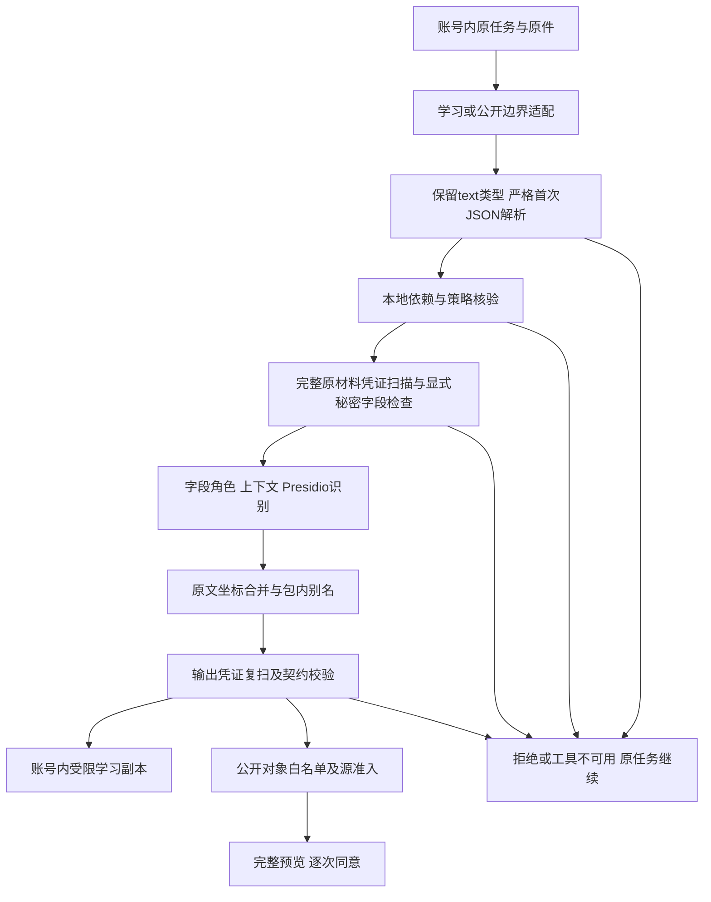

# 公共脱敏：R3 后审计与 R4 调整实施方案

实施状态：R4.0入口/依赖信任、R4.1公共策略、R4.2金融/证件上下文及R4.3有界运行时已实现；三基准、修正后的完整npm/smoke/Motif、通用入口与最终摘要核验完成。R4.4的独立留出、真实RSI/桌面及正式接收端仍未验收，识别质量不达标，PR162保持Draft。[实施与新证据](../../experiments/privacy-benchmark-20261108-r4.md)含逐项实施后审计、失败、未解决边界和后续设计。正式服务、用户原件、认证证据和账本未改。

以下保留启动实施前的审计/设计依据：审计源码 `a3579aa2595824711c1cf5173a823512ff02fe95`，当时运行时 `4f6adedb`、规则 `ea819fc6`。后文的“计划/建议/未实施”描述属于该设计快照，不能当作当前执行结果；实际失败、退出条件和采用决定见新记录。官方GLiNER PERSON-only已按冻结门槛筛选，因额外遮盖及语义损失未采用，未事后降低标准。

## 结论与优先级

现有方案有可复用的公共入口、成熟识别器和严格共享白名单，但**“接口已接通”“工程回归通过”不能代替“所有入口都正确执行规则”或“隐私质量达标”**。质量不足的主要原因不是类别数量本身：已承诺类别中的姓名、地址、金融信息仍有显著漏遮；投影预解析还会改变输入，使同一内核得到不同材料。

先处理三个阻断：

1. **解析边界不一致**：纯数字文本被转成数字后逃过文本识别；重复JSON键在进入公共内核前丢值。优先修实际入口，不能只增加内核正例。
2. **依赖与运行边界不完整**：安装校验不能保证每次运行所指向的扫描器可信；冷启动、模型重复加载及SDK线程的时间约束需单独解决。超时不得算安全结果。
3. **按类别补识别并建立质量门槛**：保留成熟工具，先用上下文/字段补金融和身份识别，再用官方GLiNER接口评估姓名补充。整体模型替换及全部标签并集都缺乏现有证据支持。

当前不会实施自动公开语义、全局低阈值、全部长数字遮盖、跨账号身份映射，也不会通过缩小benchmark分母、放宽超时或修改证书守卫求通过。

## 审计范围与证据

本次是源码与已执行证据审计，另在服务器隔离环境对冻结运行时执行7项合成探针。覆盖内核、投影、两个Web宿主、SDK、学习模型读取、公开导出、共享控制和桌面出口；没有以此宣称完成Mac真实任务、正式接收端或所有第三方MCP的隐私认证。

| 边界 | 核对的实现与结论 |
| --- | --- |
| 共同内核 | [`geneloop_privacy.py`](../../../src/adapters/geneloop_privacy.py)、[`rsi_text_privacy.py`](../../../src/adapters/rsi_text_privacy.py)：递归键值、结构字段、单包别名、原文/规范化、前后凭证扫描及拒绝；任意数值与未识别正文仍可能保留 |
| Web与离线 | [`geneloop_learning_trace.py`](../../../src/adapters/geneloop_learning_trace.py)、[`harless_learning_trace.ts`](../../../src/adapters/harless_learning_trace.ts)、两个`dsh_*_tasks.ts`：共同投影已接，但投影普通JSON预解析有缺陷；14/14旧控制没覆盖这类变形 |
| SDK | [`harness_runtime.py`](../../../src/adapters/harness_runtime.py)：原run/close结果与observer保留、内存限量、后台准入；线程等待超时不等于终止识别，当前不能称全入口统一120秒处理上限 |
| Paper/PPT旧学习器 | [`rsi_learning_trace.py`](../../../src/adapters/rsi_learning_trace.py)、`learn-web-paper-tasks.py`、`learn-web-ppt-tasks.py`：v2结构投影仍交原编译/认证，v3仅兼容诊断；不得因v4增加正文就改动成熟证书/原证据 |
| 学习模型读边界 | `dsh_trace_rsi_learning.ts`、`dsh_revision_rsi_learning.ts`、`capability_proposal.py`、`capability_goal_proposal.py`、`capability_construction_history.py`、`capability_evolution_investigation.py`、`evolution_benchmark_gene.py`：可见内容/错误走公共内核，原件仍由宿主私有读取；跨次调用的内容别名关联还需语义验证 |
| 导出 | operation library强制准入；online manifest/efficiency registry/construction library的`--public`准入，默认私有导出仍保留原字节。私有导出不等于共享对象，不能单靠CLI约定推导所有外部发布安全 |
| 共享与桌面 | `rsi_sharing.ts`、`harless_rsi_sharing.ts`、`schemas/rsi-shared-tool-flow.schema.json`、`apps/desktop/src/privacy.ts`：默认关闭、严格tool_flow、账号来源、预览摘要/逐次同意、无重定向/自动重传；正式认证与持久回执未验收 |
| 外围边界 | 用户正常下载、任务模型/MCP的授权原件读取继续沿原权限；第三方服务留存、用户手动外传、历史数据回填及二进制内容OCR/人脸/声纹不在本轮已验证能力内 |

[R3全量结果](../../experiments/privacy-benchmark-20261108-r3.md)、[七变体/模型对照](../../experiments/privacy-diagnosis-20261108-r3.md)、[工程原记录及新增审计](../../debug/privacy-platform-20261106.md)、[合成探针回执](../../debug/artifacts/privacy-audit-20261108/boundary-probes.json)与[实际工具接口](../../debug/artifacts/privacy-audit-20261108/installed-features.json)分别提供证据，不混写成同一种验收。

### 已确认缺陷与未验证风险

| 编号 | 发现、证据等级与影响 | 处理 |
| --- | --- | --- |
| A01 / P1 | **已复现真实工具**：`_content()`将纯数字消息普通`json.loads`为int，随后普通数值原样通过；相同电话字符串直接调用内核会遮盖，经投影则保留。影响聊天、工具文本及其Web/SDK/离线采集 | 保留text的原类型，修投影，覆盖全入口 |
| A02 / P1 | **已复现真实工具**：参数/消息中的重复password键，直接内核拒绝，但预解析先留下最后空值后投影准入。该例丢掉的首值没有输出，不能声称此例直接泄漏；它证明源材料准入政策被绕过 | 所有学习入口在首次JSON解析时拒绝重复键；共享不得绕过源准入 |
| A03 / P1 | **已复现受控替身**：`_scan()`接受任意绝对可执行文件，退出0即视为无命中；安装器核验摘要/版本，但运行时不再次验证。未证明服务器实际使用假扫描器，也不是攻击者已获得配置写权限 | 服务启动/worker初始化核验受保护的依赖清单，篡改/漂移拒绝 |
| A04 / P1 | **全量基准已证实**：声明范围内姓名6865/11529、地址637/3531、卡号669/2029完整遮盖；不能靠删除范围外标签解决这些漏遮 | 按字段/上下文/语言分解，逐类选成熟识别器 |
| A05 / P1 | **全量基准已证实**：同准入凭证残留2590→2590，293未知；原生未命中的凭证仍未充分处理 | 先对现有反例分类，再有限扩展成熟扫描配置；不靠提高拒绝率宣布改善 |
| A06 / P1 | **部分证实**：并发回归3失败/2取消，顺序复验通过；TS每次启动Python，中文权重冷加载慢；SDK后台线程没有整体可强制终止期限。尚无受控试验证明某个参数是超时主因 | 单独资源实验，阶段计时，先限制并发，再评估常驻模型worker |
| A07 / P2 | **代码确认/语义影响未量化**：别名以单次`learning_view`为作用域，独立返回中的`<PERSON_1>`可能指不同人；run/call/packet句柄另有宿主内映射 | 明示包级别名作用域，禁止跨包据同字面合并身份，补多轮RSI验证 |
| A08 / P2 | **代码确认**：自由数值、通用字段、日期/组织/年龄的条件识别不充分，技术地址与个人地址也有分流；单包正则无法解决所有语义歧义 | 以可信schema/字段角色补提示，保留科学数值；未支持的身份上下文单列 |
| A09 / P2 | **代码确认**：动态枚举依赖所支持实体；评测10类仅为固定范围，实际还存在MAC/UUID/ID/EMAIL等标签。依赖漂移可改变行为，评测映射不等于运行时策略 | 固定有效实体/字段/别名映射与策略摘要，原生标签及全标签结果继续保留 |
| A10 / P1验收缺口 | 已见语料、同分母残留/额外遮盖代理、有限语义控制不能证明独立匿名化、身份关联风险或真实RSI后继质量。214 Python/9 Node跳过、Mac/接收端与GitHub未启动CI分别保留 | 新来源/模板的锁定留出、真实任务与设备单独验收 |

## 调整后的公共处理流程

原件仍由宿主保管；模型执行正常任务、编译器核验来源和证书守卫仍用原权限及原字节。账号内学习副本经过脱敏仍是受限材料，不能直接变成可公开语义。公开路径继续只允许tool_flow；日期、单位、研究事实和任务目标保留不等于同意共享整段正文。

### 1. 解析与数据类型：先修正确性

- `_content`保留原始text字符串；解析嵌套JSON的责任交回共同内核。不得将文本`123...`、`true`、`null`自动转成数值/布尔/空值再送脱敏。
- 参数、JSONL事件及catalog等确实要求JSON的输入，在**第一次解析**复用标准库`object_pairs_hook`拒绝重复/转义同名键；资源上限和异常拒绝沿用共同实现。内部对象不能恢复已丢掉的原值，事后复扫不能补救。
- 将严格解码函数作为内核的可复用入口，投影器调用同一函数；不再复制解码规则。普通合法非JSON正文仍按正文处理，错误的强类型JSON参数拒绝，不回退原文。
- 不盲扫所有数字。明确phone/account/id等字段使用现有结构提示；未知数值需结合可信schema或父字段上下文处理。科学测量、计数、阈值与代码地址必须有负例。
- 将A01/A02变为失败先行的入口测试，包含消息、参数、工具结果、离线JSONL、共享源准入、SDK；要求预期准入与输出同时一致。不得只测`learning_view({'text':...})`。

### 2. 策略与可诊断性：固定一个契约

复用现有公共入口，计划新增`config/geneloop-privacy-policy-v1.json`及`schemas/geneloop-privacy-policy.schema.json`，供内核加载，评测从相同配置读取类别映射。它只描述字段、实体、动作、已批准协议词及工具来源，不新增Registry、IR或场景分支。已有`policy-scope-v1.json`为R3评测快照，保留不改。首次严格解码和工具核验分别收敛为内核可复用函数；TypeScript只编排调用，不另实现一份识别规则。

| 类别/数据 | 建议动作与依据 |
| --- | --- |
| 明确密码/令牌/密钥字段、已确认凭证命中 | 整份学习材料拒绝；身份、凭证字段的默认值/嵌套值同样检查；例外仅限有类型的布尔能力标志/词元计数，不能扩为后缀通行证 |
| 姓名、电话、邮箱、证件、金融账户、私有引用/账号标识 | 按识别跨度/可信字段替换；别名包内一致；保留扩展名或不透明宿主引用，不给模型原私人路径 |
| 日期/年龄/组织/健康事实/车牌等关联信息 | 按身份上下文处理；研究年份、统计事实、引用文献等不全局删除。未实现的上下文规则明确列为缺口，不能只在文档说“条件处理” |
| 科学数值、代码、协议、公开来源 | 保留任务含义；“看起来像hash”不自动证明安全。宿主已验证的证据句柄与任意用户字符串应在适配层区分 |
| 二进制 | 学习投影继续省略；当前没有OCR、人脸/声纹保证。需提取文本时先经既有受控读取，再进入同一文字入口 |

保留`learning_view`成功返回JSON、失败抛通用异常的兼容外观。内部给出固定原因码与阶段计时：策略拒绝、凭证命中、输入异常、依赖不可用、扫描器错误、资源/时间未知分开统计。原因只含枚举/计数/版本，公开响应不带原文、原始异常、命中值或低熵身份的可枚举摘要。未知仍不可准入，但不能统计为成功识别。

### 3. 识别：成熟工具分工，先保精度再扩召回

| 能力 | 保留/调整设计 | 采用前证据 |
| --- | --- | --- |
| 规则/字段/替换 | 继续Presidio `PatternRecognizer`、`LemmaContextAwareEnhancer`和官方Anonymizer；字段角色向既有识别器提供上下文。NFKC+原文姓名现有修复保留 | 当前安装版本已验证这些接口；不重写NER或自行实现卡号校验 |
| 姓名 | 第一候选为**只补PERSON**的官方`GLiNERRecognizer`，先比较纯模型/姓名并集，其他标签仍用现有配置；中英混写、中文名+英文称呼、引用作者/变量名负例分别评分 | R3全标签并集会多遮正文，不能据此推断PERSON-only一定改善；必须新实验、新配置验证 |
| 地址/位置 | 区分明确个人地址字段与任务地名/科研地点，复用上下文和模型实体；不把所有LOCATION无条件视为可以删的任务信息 | 分开家庭地址、城市、国家、坐标和非敏感地点负例；缺乏上下文时保留缺口说明 |
| 卡号/证件/金融账户 | 保留官方校验器，但校验失败不作为隐私放行条件。对明确“银行卡号/证件号”等字段或上下文，使用Presidio字段/弱模式+上下文增强补候选 | 有效/无效校验、中文贴边、空格/连字符/全角、长科学数值负例；不全局遮长数字 |
| 凭证 | Gitleaks默认规则仍为底座，显式字段仍整包拒绝。先按已准入残留的类型、格式/上下文、原生规则排除、包装/解码及标注可提取性分组，再决定少量配置扩展 | 复用Gitleaks配置继承默认规则；不复制自己的秘密扫描器，不为提高召回直接取消所有熵/允许项 |
| OpenMed | 保留已测反例与可复现锁定，不进入首批默认候选 | 本配置未支持替换，避免同时引入两个重型模型扩大成本和不确定性 |

Presidio官方提供[上下文增强](https://github.com/data-privacy-stack/presidio/blob/main/docs/tutorial/06_context.md)及[GLiNER集成](https://github.com/data-privacy-stack/presidio/blob/main/docs/samples/python/gliner.md)。本轮另外核验固定`presidio-analyzer==2.2.365`实际导出`GLiNERRecognizer`；先前按单一子模块路径查找得到false不等于接口缺失，以实际导出/签名回执为准。是否能与固定GLiNER0.2.22、Transformers及中文分词依赖同环境运行还未验收；先做隔离依赖兼容检查，冲突时用官方`RemoteRecognizer`对接仅本机受限worker，不增加公网PII服务。

模型沿用已核验safetensors、revision、许可证、离线加载和严格权重检查。官方接口的实际分词、分块/重叠、标签、flat_ner及阈值均记入新快照；不能因为换成官方适配就声称复现原600条成绩。长文本必须覆盖全文或报告未知，不能静默裁前缀；分块跨界身份、路径与凭证另有测试。

[Gitleaks v8.30文档](https://github.com/gitleaks/gitleaks/blob/v8.30.0/README.md)支持继承默认配置，但默认规则的关键词、熵、允许项也有具体限制；这些限制可在[固定规则文件](https://github.com/gitleaks/gitleaks/blob/v8.30.0/config/gitleaks.toml)核查。先取证后扩展规则，新配置独立版本；R3原生基线不变。公开代码发布时人工核验的hash误报，不能自动转为用户学习数据的“hash白名单”。

### 4. 运行：先消除无谓冷启动，保持隔离和失败关闭

1. 初始化时核验Gitleaks实际二进制摘要/版本、Presidio/spaCy及模型版本、策略和模型来源；期望值来自受保护部署配置/受版本控制的官方资产表，不能只信与可执行文件同目录可一并修改的自报清单。原件/证书守卫另行保留。
2. 私有元数据记录准备、排队、模型加载、原文扫描、识别、替换、输出扫描与总耗时；保留120秒现有外层限制和8秒扫描限制，分别报告。不延时求绿。
3. 首先让本项目重型基准、全量回归与冷启动验收分时运行；测队列/CPU/内存，并明确线程/并发配置。SDK需要可终止的任务级处理边界，`Thread.join(timeout)`不能冒充已经取消。
4. 仅在冷启动被受控实验证实是主要成本后，引入由现有宿主管理的有界本地worker池；TypeScript负责排队/取消/Python桥接，Python复用已加载模型。复用现有模块和JSON协议，不另起独立服务生命周期。每包重建别名/临时缓存，跨账号不保留内容；取消/崩溃/重启后拒绝未完成派生物。
5. worker不可用、队列满、超时都不写可读取的半成品；正常任务返回、交付文件、私有账本继续成功。SDK及离线写入也应采用现有Web创建临时文件后原子发布的模式，并拒绝读取同时存在拒绝标记的旧副本。

### 5. 学习、共享和认证维持独立边界

- 公开共享仍严格限定现有tool_flow。源准入失败不降级为“只分享结构”；成功预览、发送与本地副本使用同一份已核验字节。正式接收端需单独认证、幂等标识、持久回执和异常恢复验收，HTTP成功码不足以证明持久接收。
- 单包别名仅表达包内关系；多轮工具返回明确标注别名作用域，不能把两个包的`PERSON_1`推断为同一用户。会话内长期一致是否有必要，留给RSI语义对照，不默认持久化映射。
- 研究读边界保留宿主不透明句柄，宿主解析回原件后核验权限/哈希。不得用已脱敏路径到文件系统找原件，不能重签旧认证材料。
- 新代码字节若触发成熟库守卫，先核验是否只改隐私派生路径，再走既有精确兼容登记/重新认证；不得加入宽泛“隐私代码变化全部兼容”。

## 分步实施与交付

以下是**建议实施顺序与验收条件**，不是已经完成的R4成果。先冻结配置和门槛，再改规则；每个阶段保留失败和新运行ID。

| 阶段 | 修改位置与交付 | 验收/退出条件 |
| --- | --- | --- |
| R4.0：入口与可信执行 | `geneloop_learning_trace.py`严格解析/保留文本；内核复用解码入口；扫描器初始化核验；补真实投影/SDK/共享源测试及固定拒绝原因 | A01电话无残留，A02全入口拒绝，未核验/被替换扫描器拒绝；正常数字/协议/原件不变；专项真实工具无跳过 |
| R4.1：类别策略与证据 | 一份版本化策略和schema、内核加载、评测读取；分类现有凭证残留、卡号/证件/地址反例；原因枚举/私有计时 | 10类声明及额外类别映射一致，显式身份/秘密字段和未知共享字段控制全过；不覆写R3政策/金标 |
| R4.2：识别候选 | 先金融/证件上下文扩展；再官方GLiNER PERSON-only；各自单因素、新依赖锁/配置/模型摘要；不同时改变阈值、标签和基准 | 同分母减少指定类别漏遮，保留旧命中；正文/语义无超过预冻结界限的退步；代价与每阶段失败单列。不达标则不采用候选 |
| R4.3：可用性 | 测单进程冷/热与并发；必要时有界worker/取消/原子发布；SDK/TS/离线统一外层处理定义 | 无“超时当拒绝识别成功”；每条材料accepted/rejected/unavailable有闭环；原任务不被阻塞，跨账号隔离/重启取消检查通过 |
| R4.4：冻结与全验收 | 三基准全量、未知受控诊断、全场景/两宿主/SDK/研究导出、完整回归；真实桌面及RSI保留原件/脱敏副本对照 | 达到下面门槛才考虑转Ready；否则继续Draft，保留质量未达标。Mac/接收端缺项不算完成 |

在开始R4.0前，需对当前主线与并行PR做联合集成检查：本轮查得main `1d1e16f4`，PR162此前整合的基线为`cdc3a6a9`；PR163修改`config/rsi-privacy-code-compat.json`、`scripts/learn-web-ppt-tasks.py`、`harless_ppt_learning.ts`及相关测试。先在独立集成检出比对，保留两侧改动，再测PPT证书/采集/学习，不把当前分支旧基线的回归外推为最新主线整合通过。PR161/163继续由各自负责人推进，不在本方案中合并。

## R4 验证协议与质量门槛

本表为建议预注册的工程/研究门槛，不是匿名化保证或法律结论。业务可接受的身份关联风险尚无正式批准值；未给出该风险结论前不启用公开语义共享。

| 维度 | 预先固定的要求 |
| --- | --- |
| 明确字段/变形/故障安全 | 身份字段标注零残留；合成凭证、重复/转义键、数字文本、嵌套/Unicode/解码、无效依赖、超限/取消等预设安全控制全部达到预期。拒绝不能回退原文，也不能以双方均失败满足一致性 |
| 通用PII | 三基准原样全量；逐类别、语言、实体/文档报告完整遮盖、部分遮盖、strict/exact/partial/type、金标外字符和正文块损失；R3全部已完整遮盖的实体零回退。声明范围与全标签表并列，不删校验失败或难例 |
| 候选开发门槛 | 在固定开发集上指定改动类别完整遮盖数严格增加；其余声明类别无丢失；新增金标外遮盖≤非PII字符的0.1个百分点，16字符以上正文块保留率下降≤0.5个百分点；120/120现有任务要求全部保留。数值只是候选筛选线，正式质量仍需下面留出验证；如需改门槛先另立协议，不能看到成绩后改 |
| 凭证 | 11030文件及67896行全保留；原生与模块分别报告。同准入队列与已准入残留都报告；不允许新增已确认T值残留。改善需同分母残留下降，单纯多拒绝/超时不算；内层scanner_error与策略命中分开 |
| 未知和性能 | 保留R3的293未知；独立新ID、相同120秒及固定代码/并发分别诊断，不把诊断重写为正式分数。冻结版全量不应再有未归因的evaluation_error；超时有明确处理与可用率。冷热p50/p95/p99、队列、CPU/RSS和处理全文比例均报告，无独占环境不作SLA因果声称 |
| 独立留出 | 新来源/新模板/新身份格式，按来源/任务簇切分并去重，不按简单行随机切分；金标不交识别器。含中英混写、少见姓名、作者/变量/城市负例、真假校验号及文本/结构同值。锁定后仅一次验收，失败回开发；训练重叠未知如实记录 |
| 留出数值目标 | 每个承诺类别分别报告召回/完整遮盖及bootstrap或适合实体簇的区间，不用微平均掩盖弱类；建议候选目标为各类完整遮盖≥99%、金标外遮盖≤0.5%。样本不足的类别标为证据不足，不凭零失败宣称已达标；零样例没有召回率。即便达到也不等于不可重识别 |
| 全场景 | 9场景及未来自定义场景×两个Web宿主、离线、SDK的同策略测试；新增7项探针/变形家族同时覆盖原拒绝与正例；研究学习器/错误、公开导出各有断言。不是只测Paper/PPT，也不机械把所有benchmark文件乘遍所有UI |
| 工程回归 | 按项目`npm test`完整集合、smoke和Motif，保存收集清单/命令/退出码；跳过逐项说明。受影响隐私专项不能因依赖缺失跳过。GitHub启动失败单独跟踪，服务器通过不冒充CI通过 |
| 真实RSI与桌面 | 同任务/来源/模型/模式/工具/预算比较原件基线与脱敏学习副本：任务成功、后继候选构造/认证、引用定位、质量评审、人工修订、费用和耗时。Mac实际Coding、退出/重启/断网/脱敏失败、预览=实发字节及接收端回执另验收；没有结果不声称质量等价 |

首先做R4.0，不先换模型。R4.1–4.3分别形成可审阅提交；R4.4冻结后才做大规模复测，避免边跑基准边调规则和把资源争用误作算法结论。正式发布沿既有服务入口和单独授权，不属于这份实施方案的执行结果。

## 本轮交付边界

本轮交付审计、可复核合成观察与实施设计。没有新增生产规则、模型依赖、阈值或服务，没有将R3的局部收益写成质量认证。Issue141–144仍开放：141/142需入口安全与白名单证据，143需真实设备/异常全链，144需在前述验收后开放可选共享；桌面可基于稳定接口继续对接，但不能把Draft当正式隐私承诺。
